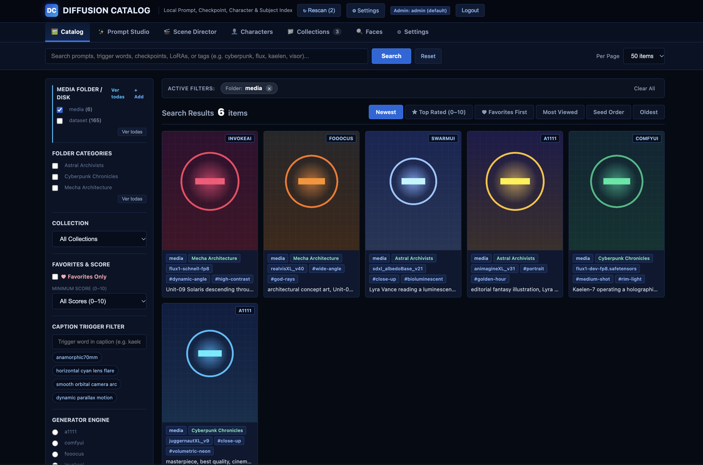
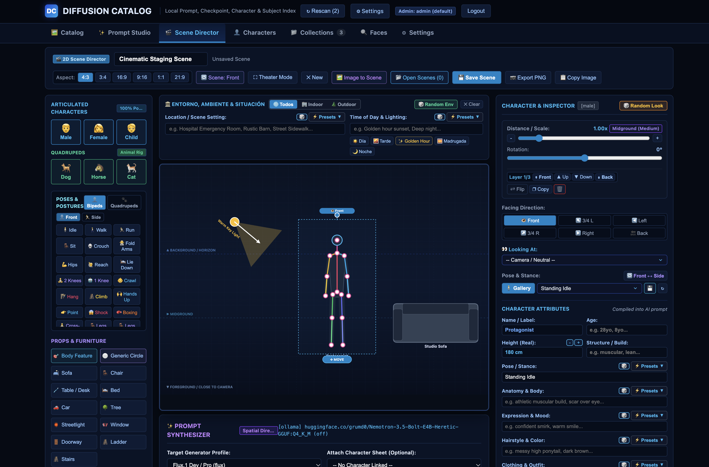

# DiffusionCatalog

<p align="center">
  <a href="https://github.com/jonathanhecl/diffusionCatalog/actions/workflows/ci.yml">
    
  </a>
  <a href="https://golang.org">
    
  </a>
  <a href="LICENSE">
    
  </a>
  
  
</p>

**DiffusionCatalog** is a fast, local-first web application and visual staging suite written in Go for indexing, searching, and organizing AI-generated diffusion images and videos.

It treats your media directory as **strictly read-only**, parsing generation prompts and technical parameters (Automatic1111, Forge, ComfyUI, Fooocus, SwarmUI, InvokeAI) in pure Go, indexing them into a local SQLite database with FTS5 and vector embeddings, and providing a powerful **Scene Director & Prompt Studio** for creative visual composition.




---

## ✨ Key Features

### 🚀 Zero-Config & Pure-Go
- **Zero CGO / Zero External Database**: Single self-contained binary powered by `modernc.org/sqlite` with WAL mode and embedded HTML5/CSS dark-navy UI.
- **Non-Destructive Folder Indexing**: Automatically watches and indexes existing media folders without moving, renaming, or modifying your files.
- **Multi-Root Support**: Point to multiple media drives and folders simultaneously.

### 🔍 Deep Diffusion Metadata Extraction
- **Pure-Go Byte Parsers**: Extracts generation parameters directly from PNG `tEXt`/`iTXt` chunks, JPEG/WebP EXIF `UserComment`, and companion `.txt`/`.caption`/`.json` sidecars without external binaries.
- **Supported Generators**:
  - **Automatic1111 / Forge / SD.Next**: Positive & negative prompts, sampler, scheduler, steps, CFG scale, seed, model name/hash, `<lora:...>` syntax.
  - **ComfyUI**: Parses node graph execution workflows (`CLIPTextEncode`, `KSampler`, `CheckpointLoader`, `LoraLoader`).
  - **Fooocus & SwarmUI**: Native parameters and JSON metadata.
  - **InvokeAI**: Legacy `sd-metadata` and modern `invokeai_metadata`.
  - **Video & Animations**: MP4/WebM video container inspection and companion sidecars.

### 🎭 2.5D Scene Director & Skeletal Rigging
- **Visual Staging Canvas**: Place and position multiple characters and objects in 2.5D space with customizable depth, physical height scaling, facing directions, and distance.
- **Interactive Skeletal Posing**: Built-in 2D rigging presets for both **Humanoid** and **Quadruped** actors (front, side, dynamic action poses).
- **Demographic Archetypes**: Randomize and fine-tune physical attributes (age, build, height, gender presentation).
- **Scene-to-Prompt Synthesis**: Automatically converts visual staging compositions, lighting angles, and actor arrangements into ready-to-render diffusion prompts.
- **Image-to-Scene Breakdown**: Reverse-engineer compositions from existing images using AI vision.

### 💡 Prompt Studio, Knowledge Base & Token Budget
- **Modular Knowledge Snippets**: Reusable guidelines for lighting physics, lens focal lengths, composition framing, and artistic styles injected directly into LLM prompts.
- **Live Token Budget Estimator**: Real-time LLM token counter ensuring prompts stay within context window limits.
- **Per-Model LoRA Documentation**: Keep track of trigger keywords, recommended weights, and usage notes per checkpoint and LoRA.

### 🧠 Semantic Vector Search & Local LLM Integration
- **Hybrid Search**: Combines instant SQLite FTS5 full-text keyword indexing with high-dimensional vector embeddings.
- **Ollama & OpenAI-Compatible**: Connect to local Ollama instances (`nomic-embed-text`, `llama3`, `qwen2.5`) or OpenAI-compatible servers (oMLX, LMStudio, vLLM) for semantic discovery, prompt expansion, and vision-to-prompt analysis.

### 👤 Face & Subject Recognition
- **Embedded Neural Models**: Single binary embeds OpenCV YuNet face detection and SFace 128-d deep facial recognition models.
- **Automated Identity Clustering**: Groups characters across thousands of generations, enabling seamless asset tagging and character reference tracking.

### 📂 Agnostic Collections & Virtual Organization
- **Faceted Tagging**: Tag images with arbitrary facets (`style`, `lighting`, `mood`, `artist`, `composition`).
- **Virtual Groups & Moodboards**: Create virtual asset collections independent of disk folder hierarchies.
- **Character Profiles**: Maintain canonical prompt templates, trigger words, and curated galleries for recurring characters.

---

## ⚡ Quick Start

### Option 1: Run Directly Without Compiling (`run.sh`)

```bash
./run.sh
```

`run.sh` verifies your Go environment and launches `go run ./cmd/catalogd` directly.

### Option 2: Build Portable Binary (`build.sh` or `make`)

```bash
# Using build script:
./build.sh

# Or using make:
make build
```

This compiles a 100% static, single-file binary into `./catalogd`:

```bash
./catalogd --media-dir=/path/to/your/images --db=./catalog.db --addr=:1080
```

Open **http://localhost:1080** in your web browser.

> **Default Admin Account**: Username: `admin` | Password: `admin123` (Changeable in settings or `config.json`).

---

## ⚙️ Configuration Reference

DiffusionCatalog loads configuration from `config.json` in the current working directory, which can be overridden via command-line flags or environment variables:

| Flag | Environment Variable | Default | Description |
|------|----------------------|---------|-------------|
| `--addr` | `CATALOG_ADDR` | `:1080` | HTTP bind address (e.g. `:1080`, `127.0.0.1:8080`) |
| `--config` | `CATALOG_CONFIG` | `config.json` | Path to JSON configuration file |
| `--media-dir` | `CATALOG_MEDIA_DIR` | `./media` | Read-only folder containing diffusion images/videos |
| `--cache-dir` | `CATALOG_CACHE_DIR` | `./.cache` | Directory for cropped faces and thumbnails |
| `--db` | `CATALOG_DB_PATH` | `./catalog.db` | Path to local SQLite database |
| `--admin-user` | `CATALOG_ADMIN_USER` | `admin` | Default administrator username |
| `--admin-pass` | `CATALOG_ADMIN_PASS` | `admin123` | Default administrator password |
| `--vision-url` | `CATALOG_VISION_URL` | `""` | Optional external Python Vision Sidecar URL |
| `--auto-scan` | `CATALOG_AUTO_SCAN` | `true` | Automatically scan media directory on boot |
| `--auto-scan-interval` | `CATALOG_AUTO_SCAN_INTERVAL` | `10s` | Interval for background directory sync |
| `--seed-demo` | `CATALOG_SEED_DEMO` | `false` | Populate empty media folder with demo images |

### Example `config.json`

```json
{
  "port": 1080,
  "addr": ":1080",
  "media_dir": "./media",
  "cache_dir": "./.cache",
  "db_path": "./catalog.db",
  "admin_user": "admin",
  "admin_pass": "admin123",
  "auto_scan": true,
  "auto_scan_interval": 10,
  "seed_demo": false
}
```

---

## 🐳 Docker Deployment

You can build and run DiffusionCatalog with Docker:

```dockerfile
# Build image
docker build -t diffusioncatalog .

# Run container mounting your existing media folder
docker run -d \
  -p 1080:1080 \
  -v /path/to/your/images:/media:ro \
  -v $(pwd)/data:/data \
  --name diffusioncatalog \
  diffusioncatalog
```

---

## 🧠 AI System Prompts for Prompt Studio (Settings > System Prompts)

DiffusionCatalog integrates with local LLMs (via Ollama or OpenAI-compatible backends) to automatically synthesize, remix, or caption diffusion prompts in the **Prompt Studio** and **Scene Director**.

Below are the recommended **System Prompts** to paste into the **Generation / Context System Prompt** field for each model family, crafted strictly from each model's official documentation and text encoder characteristics:

### 1. Flux.1 Dev / Pro (`flux`)
> **Encoder**: T5-XXL (Natural language narrative, zero tag-soup, supports quoted typography)

```text
You are an expert prompt engineer specializing in the Flux.1 diffusion architecture (BFL FLUX.1 [dev] / [schnell]). Generate rich, descriptive natural-language prose (3 to 5 sentences) optimized for the T5-XXL text encoder. Describe the primary subject, focal geometry, attire and tactile materials, spatial composition, camera lens (e.g., 85mm f/1.4, anamorphic), lighting direction, color palette, and surface textures. If typography appears, wrap exact words inside double quotes (e.g., "APOLLO 18"). Do NOT use Danbooru tag weights like (word:1.3). Output only the final prompt.
```

### 2. Krea 2 (`krea2`)
> **Encoder**: Aesthetic Multimodal Diffusion (Tactile surface micro-textures, editorial optics, and material realism)

```text
You are a senior art director and prompt engineer for Krea 2 (Krea AI v2). Synthesize a high-aesthetic, structured natural-language prompt following the formula: [Subject & Pose] + [Environment & Setting] + [Medium & Tactile Micro-Textures] + [Lighting Direction & Optical Setup]. Focus on hyper-tactile surface textures (skin pores, fabric weaves, brushed metals), editorial studio or golden-hour lighting, medium-format analog film stock (Kodak Portra 400, Hasselblad H6D), and deliberate depth-of-field. Output only the final prompt.
```

### 3. MiniMax Hailuo H3 Video (`minimaxh3`)
> **Encoder**: Video Diffusion Transformer / DiT (Single physical camera motion, temporal dynamics, 24fps)

```text
You are a cinematic director and prompt specialist for MiniMax Hailuo H3 AI video generation (Video-01 DiT architecture). Structure every prompt with: 1) EXACTLY ONE primary physical camera motion from the standard MiniMax taxonomy ("The camera pushes in slowly", "The camera pulls out smoothly", "The camera trucks right", "The camera pans left", or "The camera holds a static shot"), 2) Continuous subject micro-actions across time, 3) Dynamic environmental physics (drifting steam, wind ripple, shifting reflections), and 4) 24fps cinematic lighting and film aesthetic. Output only the final video prompt.
```

### 4. Qwen-Image 2.1 (`qwen-image`)
> **Encoder**: Qwen-VL Multilingual Spatial Encoder (Layout reasoning, native text in quotes, transparency)

```text
You are an expert prompt engineer for Qwen-Image (powered by Qwen-VL spatial encoders). Create a spatially rigorous, semantically rich prompt following the formula: [Medium & Style] + [Subject & Attributes] + [Spatial Layout & Placement] + [Lighting & Atmosphere] + [Surface Details] + [Exact Typography in Quotes]. Specify foreground/background placement, realistic material physics, and wrap any text or signage inside double quotation marks. Output only the final prompt.
```

### 5. SDXL / Illustrious / Pony (`sdxl`)
> **Encoder**: Dual Text Encoders (CLIP ViT-L + OpenCLIP ViT-bigG, native 1024x1024 framing)

```text
You are an expert prompt engineer for SDXL 1.0 and SDXL-derived models. Generate an optimized hybrid prompt combining concise natural descriptive phrases with targeted cinematic photography tokens suited for native 1024x1024 generation. Specify medium and artistic style, subject framing, attire, environmental backdrop, lighting setup, and camera lens details (e.g., 35mm film still, 85mm f/1.8, volumetric lighting). Output only the final prompt.
```

### 6. Stable Diffusion 1.5 (`sd15`)
> **Encoder**: CLIP ViT-L/14 (Comma-separated weighted tokens, 77-token budget)

```text
You are an expert prompt engineer for Stable Diffusion 1.5 checkpoints. Generate a weighted, comma-separated token prompt optimized for the 77-token CLIP ViT-L/14 text encoder at 512x512 to 768x768 resolutions. Include quality prefix anchors (masterpiece:1.2, best quality:1.1), detailed subject tags, posture, attire, environment, lighting, and camera perspectives. Use attention syntax (keyword:1.1) to (keyword:1.3) strategically on key elements. Output only the final comma-separated prompt.
```

---

## 🎨 Sample Prompts by Model (Copy & Paste)

To help test DiffusionCatalog's prompt parser, full-text search, and Prompt Studio, here are generic ready-to-use prompts crafted according to the native prompting grammar of each modern model:

### 1. FLUX.1 (`[dev]` / `[schnell]`)
> **Style rule**: Natural descriptive English narrative, zero booru tag soup (`masterpiece, best quality`), explicit light physics, material textures, and typography wrapped in double quotes.

```text
A 35mm film photograph of an astronaut in a worn, functional white space suit sitting on a weathered wooden bench inside an overgrown Victorian glass conservatory. Warm morning sunlight streams through dusty glass panes, casting soft volumetric god rays across the room. Delicate green ferns and blooming orange orchids surround the bench. The words "APOLLO 18" are cleanly stenciled in faded black serif lettering across the left chest patch. Natural film grain, shallow depth of field, 85mm portrait lens, muted vintage color palette, authentic photorealism.
```

### 2. Krea 2 (Krea v2 Turbo)
> **Style rule**: Structured formula `[Subject] + [Action/Pose] + [Setting] + [Medium & Texture] + [Lighting & Camera]`. Highly tactile material descriptors, clean lighting cues, and exact lens characteristics.

```text
Editorial fashion portrait of a cybernetic warrior woman wearing an avant-garde matte-black armor and high-collar tailored wool coat. Standing inside a brutalist concrete atrium during blue hour twilight. Cinematic cool blue key light with warm amber rim light contouring her silhouette. Shot on Hasselblad medium format, 85mm f/1.4 lens, crisp tactile fabric weaves, polished carbon fiber reflections, muted Nordic color grading, subtle film grain.
```

### 3. MiniMax Hailuo H3 (Hailuo Video / DiT)
> **Style rule**: Cinematic video grammar with a single primary physical camera action (`The camera pushes in...`, `The camera trucks right...`), subject motion dynamics, temporal lighting, and 24fps film look.

```text
A cinematic medium shot of an antique clockmaker examining a glowing golden pocket watch inside a dimly lit workshop. The camera slowly pushes in on the intricate spinning brass gears as soft golden dust particles float through warm tungsten lamplight. Gentle smoke rises from an incense burner in the blurred background. 24fps, cinematic lighting, shallow depth of field, 4k photorealistic movie still.
```

### 4. Qwen Image 2.1 (Qwen-VL)
> **Style rule**: Narrative compositional structure with photographic medium, subject placement, environmental lighting, and exact typography enclosed in double quotes `" "`.

```text
A commercial product photograph of a modern matte-emerald glass coffee canister centered on a polished white terrazzo countertop. Behind the canister, a lush monstera plant casts soft geometric shadows against a warm beige plaster wall. High-angle 45-degree composition, soft studio diffused window lighting from the left, creating clean specular highlights. Minimalist Scandinavian aesthetic, 8K resolution, with the brand name "ROAST & CO." printed cleanly in crisp white sans-serif lettering across the front label.
```

### 5. SDXL 1.0 (Stable Diffusion XL)
> **Style rule**: Hybrid concise natural phrasing paired with cinematic photography tokens. Benefits from dual text encoders (OpenCLIP + CLIP), native 1024x1024 composition framing, and a concise negative prompt.

**Positive Prompt**:
```text
cinematic film still, a solitary wanderer in a weathered brown leather jacket walking through a neon-lit cyberpunk alleyway at night, reflections on wet asphalt, volumetric steam rising from street grates, dramatic rim lighting, shallow depth of field, 35mm photograph, Kodak Portra 800, highly detailed, 8k
```

**Negative Prompt**:
```text
ugly, deformed, noisy, blurry, distorted, out of focus, low quality, worst quality, bad anatomy, bad hands, cartoon, 3d, render, watermark, signature
```

### 6. Stable Diffusion 1.5
> **Style rule**: Comma-separated token syntax with attention weights `(keyword:weight)`, booru tag descriptors, and an explicit defensive negative prompt to suppress anatomical anomalies and low-resolution artifacts.

**Positive Prompt**:
```text
(masterpiece:1.2), (best quality:1.1), (photorealistic:1.3), 1girl, solo, portrait, cybernetic samurai armor, intricate mechanical details, glowing neon accents, katana on back, standing in rain, tokyo street background, bokeh, (volumetric lighting:1.1), ray tracing, 8k uhd, dslr, soft lighting, high quality, film grain
```

**Negative Prompt**:
```text
(worst quality, low quality:1.4), (deformed, distorted, disfigured:1.3), poorly drawn, bad anatomy, wrong anatomy, extra limb, missing limb, floating limbs, (mutated hands and fingers:1.4), disconnected limbs, mutation, mutated, ugly, disgusting, blurry, amputation, watermark, text, signature
```

---

## 🏛️ Architecture & Extensibility

DiffusionCatalog is structured around **Hexagonal Architecture** principles, maintaining strict boundaries between domain models and external systems.

```
cmd/catalogd/          # Application entrypoint
internal/
├── domain/            # Core business entities & port interfaces (zero external dependencies)
├── usecase/           # Application services (CatalogService, ScannerService, AuthService)
├── adapter/
│   ├── metadata/      # Pure-Go parsers for PNG chunks, EXIF, and sidecars
│   ├── storage/sqlite/# Pure-Go SQLite adapter with FTS5 and vector ranking
│   ├── ollama/        # REST client for Ollama & OpenAI-compatible endpoints
│   ├── vision/        # Pluggable face & subject detection adapter
│   └── web/           # Embedded web templates, static CSS, and HTTP server
└── bootstrap/         # Embedded Python Vision Worker extraction and environment checks
```

For in-depth architecture details, database schema tables, and extraction pipelines, see [docs/ARCHITECTURE.md](docs/ARCHITECTURE.md).

---

## 🤝 Contributing

Contributions, bug reports, and suggestions are welcome! Please review [CONTRIBUTING.md](CONTRIBUTING.md) for details on code style, conventional commits, and running tests.

```bash
# Run unit tests
make test

# Code quality check
make vet
```

---

## 📄 License

This project is licensed under the [MIT License](LICENSE) © 2026 Jonathan Hecl.
