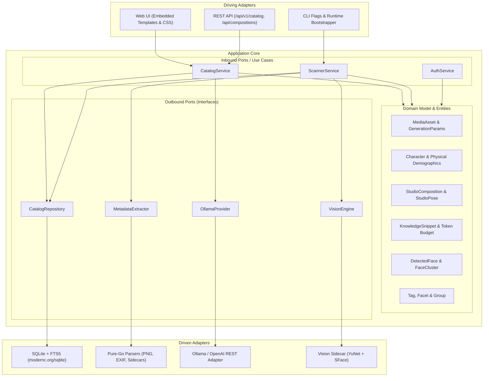

# Architecture & Design Reference

`DiffusionCatalog` is engineered as a local-first, high-performance media catalog and visual prompt engineering suite for AI-generated images and videos.

---

## 1. Hexagonal / Clean Architecture

The project strictly adheres to **Hexagonal Architecture (Ports and Adapters)**. The domain and business logic remain completely decoupled from transport protocols, database drivers, and external AI providers.

### Layer Responsibilities

1. **`internal/domain`**:
   - Pure Go data structures representing business concepts (`MediaAsset`, `GenerationParams`, `Character`, `StudioComposition`, `StudioPose`, `KnowledgeSnippet`, `DetectedFace`).
   - Contract port interfaces (`CatalogRepository`, `MetadataExtractor`, `OllamaProvider`, `VisionEngine`).
   - Has **zero imports** from external dependencies or adapter layers.

2. **`internal/usecase`**:
   - `CatalogService`: Query orchestration, hybrid search (FTS5 + vector similarity ranking), character and composition persistence, prompt synthesis.
   - `ScannerService`: Non-destructive directory traversal, media classification, concurrency-controlled metadata extraction, face detection orchestration, and background sync.
   - `AuthService`: Session management and password verification.

3. **`internal/adapter`**:
   - **`metadata`**: Pure-Go parsers for PNG text chunks (`tEXt`/`iTXt`), JPEG/WebP EXIF bytes, MP4/WebM containers, and sidecar metadata (`.txt`, `.caption`, `.json`).
   - **`storage/sqlite`**: Pure-Go driver (`modernc.org/sqlite`, CGO-free) executing WAL-mode transactions, FTS5 full-text queries, cosine similarity ranking, and schema migrations.
   - **`ollama`**: Universal LLM client supporting native Ollama endpoints (`/api/chat`, `/api/embeddings`) and OpenAI-compatible endpoints (`/v1/chat/completions`).
   - **`vision`**: Pluggable face and subject detection adapter. Supports `NoopEngine` and `HTTPWorkerEngine` (embedded Python FastAPI sidecar).
   - **`web`**: Single-binary HTTP server with embedded HTML/CSS, UI routing, and REST endpoints.

---

## 2. Supported Diffusion Metadata Formats

The metadata extraction pipeline reads technical parameters from the raw byte streams without invoking external binaries like `exiftool` or `imagemagick`:

| Generator / UI | Mechanism | Extracted Metadata |
|----------------|-----------|--------------------|
| **Automatic1111 / Forge / SD.Next** | PNG `parameters` chunk, EXIF `UserComment` | Positive & Negative prompts, Steps, Sampler, Scheduler, CFG Scale, Seed, Base Model name & hash, LoRA tags (`<lora:name:weight>`), Size, Clip Skip |
| **ComfyUI** | PNG `prompt` & `workflow` JSON graphs | Node graph traversal: `CLIPTextEncode` (prompts), `KSampler` / `SamplerCustom` (steps, cfg, seed, sampler_name, scheduler), `CheckpointLoaderSimple` / `UNETLoader` (models), `LoraLoader` |
| **Fooocus** | PNG `parameters` (A1111 string or JSON dictionary) | Prompts, Base Model, Refiner, Sampler, Seed, Steps, Guidance |
| **SwarmUI** | PNG `sui_image_params` JSON | Prompt, Negative Prompt, Seed, Steps, CFG, Model, Sampler, Modifiers |
| **InvokeAI** | PNG `invokeai_metadata` / `sd-metadata` JSON | Positive & Negative prompts, Model architecture, Seed, Steps, CFG, Sampler, LoRAs |
| **Companion Sidecars** | `.txt`, `.caption`, `.json` sidecars | Plaintext prompts or structured JSON sidecars alongside image or video files (e.g. `image.png` + `image.txt` or `video.mp4` + `video.json`) |

---

## 3. Database Schema & FTS5 Indexing

The storage layer initializes a single-file SQLite database configured with:
- `PRAGMA journal_mode=WAL;`
- `PRAGMA synchronous=NORMAL;`
- `PRAGMA busy_timeout=5000;`

### Key Tables

- **`assets`**: File metadata (hash, paths, dimensions, file size, timestamps, duration), generation parameters (prompts, model, sampler, seed, steps, cfg), and category.
- **`assets_fts`**: FTS5 virtual table indexing positive prompts, negative prompts, model names, and tags for full-text keyword search.
- **`asset_embeddings`**: Stores 768-d or 1536-d float vectors generated via Ollama (e.g. `nomic-embed-text`) for semantic similarity search.
- **`tags` & `asset_tags`**: User-defined classification with arbitrary facets (`style`, `lighting`, `composition`, `artist`, etc.).
- **`groups` & `group_assets`**: Virtual collections and moodboards independent of file system directory structure.
- **`characters` & `character_assets`**: Reusable character sheets containing canonical prompts, trigger tokens, demographic attributes, and reference galleries.
- **`studio_compositions`**: Serialized 2.5D scene director layouts, camera perspectives, actor placements, and synthesized prompts.
- **`studio_poses`**: Skeletal rigging presets for humanoid and quadruped actors.
- **`knowledge_snippets`**: Modular design directives (lens rules, lighting physics, composition patterns) injected during prompt synthesis.
- **`faces`**: Bounding boxes, confidence scores, 128-d facial embeddings (SFace), and cluster assignments.

---

## 4. Hybrid Search Architecture

When querying assets, DiffusionCatalog performs **hybrid ranking**:
1. **FTS5 Exact / Prefix Search**: Queries positive and negative prompts, model names, and tags.
2. **Semantic Vector Search**: When an embedding model is configured via Ollama, queries are embedded and compared via cosine similarity.
3. **Re-Ranking / Merging**: Direct keyword matches are prioritized and boosted above loose semantic associations, ensuring deterministic recall for known prompts while enabling discovery via natural language.

---

## 5. Embedded Self-Installing Vision Worker

To maintain a zero-installation footprint:
1. The static Go binary embeds `app.py`, `requirements.txt`, and deep-learning ONNX models (`YuNet` face detection + `SFace` facial recognition).
2. On initial startup with face scanning enabled, the application extracts these files to `.cache/vision_worker/` and manages the sidecar process on `http://127.0.0.1:8091`.
3. If Python or virtual environments are not configured, the core catalog continues running normally with `NoopEngine`.
